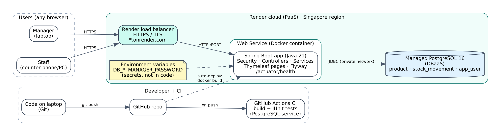
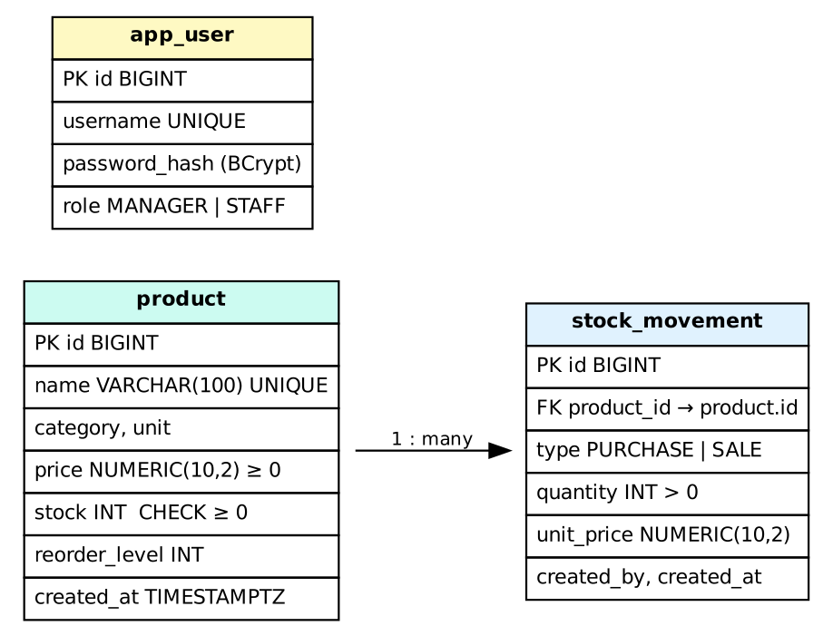

# Smart Inventory Management System (Cloud)

A cloud-based inventory system for an **electronics and mobile accessories store** (phones, chargers, cables, earbuds, power banks, smartwatches). Built with Java 21, Spring Boot 3.5, PostgreSQL and Docker, and deployed on **Render** (PaaS) with a managed PostgreSQL database.

**Live URL:** `https://<your-service>.onrender.com` (fill in after deploy)
**Demo logins:** `manager / Manager@123` (everything) · `staff / Staff@123` (sales only). In the cloud, the passwords are whatever you set in Render.

## The problem
The shop tracks stock in a register and memory. This causes three problems:
1. Fast-moving items (cables, screen guards, chargers) run out on busy weekends.
2. Costly slow items (speakers, smartwatches) lock up money on the shelf.
3. Nobody knows today's sales or profit until closing time.

Two staff at two counters can also sell the "last" pair of earbuds twice.

## What it does
| Feature | Who |
|---|---|
| Products: add, edit, list, search, delete (with validation) | Manager |
| Record **sales** (stock out) | Manager, Staff |
| Record **purchases** (stock in) | Manager |
| Login with roles; staff blocked from manager pages (403) | All |
| Dashboard: totals, stock value, low/out of stock, today & 7-day sales, 14-day chart, best/slow sellers | Manager |
| 7-day demand forecast (moving average vs exponential smoothing, picked by MAE) + restock recommendation | Manager |
| Alerts: out of stock, low stock, predicted shortage | Manager |
| **Overselling is impossible**: two staff selling the last item at the same time → exactly one succeeds (proven by `ConcurrentSaleTest`) | — |

Restock formula: `restock = max(0, predicted 7-day demand + safety stock − current stock)`, where `safety stock = ⌈1.65 × σ_daily × √lead_time⌉`.

## Architecture


- **Browser → Render load balancer (HTTPS) → Docker container running Spring Boot → managed PostgreSQL** over Render's private network.
- Config and secrets come from **environment variables**. Nothing secret is in the code.
- **Flyway** creates and versions the tables (`src/main/resources/db/migration`).
- **GitHub Actions** builds the app and runs every test on each push. Render auto-deploys from GitHub.

Data model: 

## Project layout (where things are and why)
```
src/main/java/com/digitalshop/inventory/
  config/      SecurityConfig (who can open what), AppProperties (typed settings), ClockConfig
  domain/      Product, StockMovement, AppUser: Java classes mapped to tables (JPA entities)
  repository/  Database access. ProductRepository.decrementStock = the anti-oversell query
  service/     Business rules: ProductService, StockService (@Transactional), ForecastService, Forecaster (pure maths), DashboardService (SQL), AlertService
  web/         Controllers (receive HTTP requests), form classes with validation rules
  seed/        Creates the manager/staff users and 90 days of demo data on first start
src/main/resources/
  db/migration/V1__init.sql   tables, CHECK rules, indexes
  db/migration/V2__...sql     switches the demo data to the electronics store
  templates/                  Thymeleaf HTML pages
  application.yml             settings; every secret read from an env var
src/test/java/...             JUnit 5 tests (unit, web/security, database, concurrency)
Dockerfile                    2-stage image: build with Maven, run on a small JRE
docker-compose.yml            PostgreSQL on your laptop
render.yaml                   Render Blueprint: database + web service as code
.github/workflows/ci.yml      CI: build + tests on every push
docs/                         glossary, decisions, bugs, deploy guide, forecast by hand
```

## Run it on your laptop (Windows)
Prerequisites: Java 21+ (you have 25), Docker Desktop, Git, and Maven (`winget install Apache.Maven`, or use IntelliJ's built-in Maven).

```powershell
cd D:\projects\smart-inventory
docker compose up -d db          # PostgreSQL 16 on localhost:5432 (+ inventory_test DB)
mvn spring-boot:run              # app on http://localhost:8080
mvn test                         # all tests (needs the db container running)
```
The first start creates the 2 users and 12 store products with 90 days of demo sales (turn this off with `SEED_DEMO=false`).

To run everything in containers: `docker compose --profile full up --build`.

## Deploy
See **[docs/DEPLOY.md](docs/DEPLOY.md)**: GitHub, then a Render Blueprint, then the live URL.

## Tests
| Test class | Proves |
|---|---|
| `ForecasterTest` | MA, exponential smoothing, MAE, safety stock, restock formula match hand calculations |
| `StockServiceTest` | sale/purchase change stock; overselling refused with nothing changed; DB `CHECK` blocks negative stock even if Java is bypassed |
| `ConcurrentSaleTest` | 10 threads sell the last item at once, 5 repetitions: exactly 1 succeeds, stock = 0, 1 ledger row |
| `SecurityAndWebTest` | login ok / wrong password fails; BCrypt hashes; staff → 403 on manager pages; validation (empty name, negative price, duplicate); 404; CSRF |
| `DashboardAndForecastTest` | dashboard numbers equal a hand calculation; JOIN doesn't double count; forecast window is exactly 56 days and excludes today |

## Trade-offs
- **Server-rendered pages (Thymeleaf), not React + API:** one language, less to build and defend. The cost is less interactive pages.
- **Atomic conditional UPDATE + DB CHECK, not optimistic locking:** no retries needed and correct under any load on one database. The cost is that the logic lives partly in SQL.
- **Render free tier:** no credit card, deploy from GitHub in minutes. The costs are that the app sleeps after 15 min idle (first request ~1 min) and the free database expires after 30 days.
- **Simple forecasting:** explainable and testable by hand. It ignores the weekly pattern (weekend rush), so weekend forecasts have higher error.

## Next improvements
Weekly-seasonal forecast (Holt-Winters), supplier table and purchase orders, email/WhatsApp alerts, barcode scanning, an audit log of product edits, and moving to AWS (ECS + RDS) with autoscaling.
